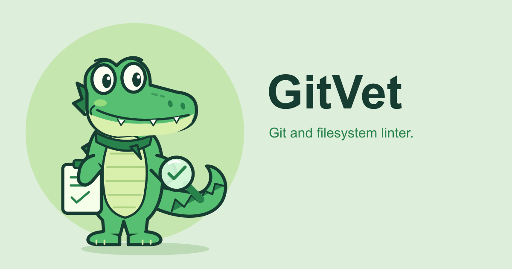

# GitVet Artwork

GitVet's original crocodile mascot carries a clipboard and a magnifying glass.



## Assets

| Asset | SVG | PNG | PNG size |
| --- | --- | --- | --- |
| Full mascot, transparent | [Source](mascot.svg) | [Export](mascot.png) | 840 x 940 |
| Circular avatar | [Vector](avatar.svg) | [Export](avatar.png) | 512 x 512 |
| Wordmark, light backgrounds | [Vector](logo.svg) | [Export](logo.png) | 900 x 250 |
| Wordmark, dark backgrounds | [Vector](logo-dark.svg) | [Export](logo-dark.png) | 900 x 250 |
| Small icon | [Vector](favicon.svg) | [Export](favicon.png) | 32 x 32 |
| Social preview | [Vector](social-preview.svg) | [Export](social-preview.png) | 1200 x 630 |

Use the full mascot when there is room for the inspection tools, and the head for avatars and small icons. Keep the original proportions and leave space around the silhouette. Use the light-lettered wordmark on dark backgrounds.

The social preview is ready for use as a repository's social image; committing it does not automatically configure GitHub's repository settings.

## Palette

| Color       | Hex       | Role                            |
| ----------- | --------- | ------------------------------- |
| Forest      | `#173D32` | Outlines and lettering          |
| Fern        | `#27824B` | Details and secondary lettering |
| Leaf        | `#57BF72` | Crocodile                       |
| Mint        | `#C5E6AE` | Avatar and accents              |
| Pale lime   | `#D9EFAC` | Belly and jaw                   |
| Paper green | `#DDEEDB` | Social preview background       |

## Editing and Exporting

The editable source is [mascot.svg](mascot.svg). Its `croc-head` and `crocodile` groups supply the geometry for every variant. Layouts and lettering are defined in [render-artwork.mjs](../scripts/render-artwork.mjs); generated SVGs are self-contained and have no external image dependencies.

Install [librsvg](https://gitlab.gnome.org/GNOME/librsvg) (`rsvg-convert`) and [pngquant](https://pngquant.org/) separately. For example, on macOS:

```sh
brew install librsvg pngquant
```

From the repository root, after `npm ci`:

```sh
npm run format
npm run artwork
```

This regenerates the avatar, both wordmarks, icon, social preview, and optimized PNG exports. Lettering uses Arial with Helvetica and sans-serif fallbacks; rasterized lettering can vary with installed fonts. Review the rendered images after changing geometry or layouts.

These are optional artwork-development tools, not GitVet runtime dependencies. Ordinary installation, linting, and testing do not require them. The artwork is covered by the repository's [MIT license](../LICENSE).
